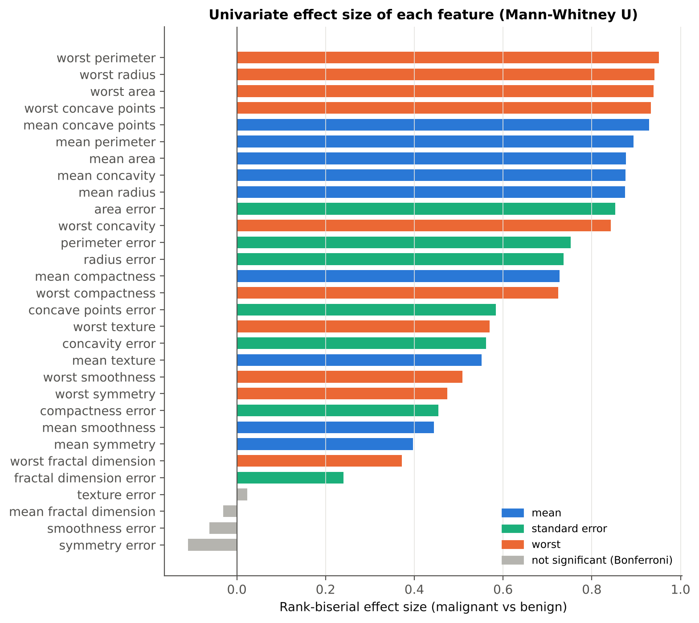
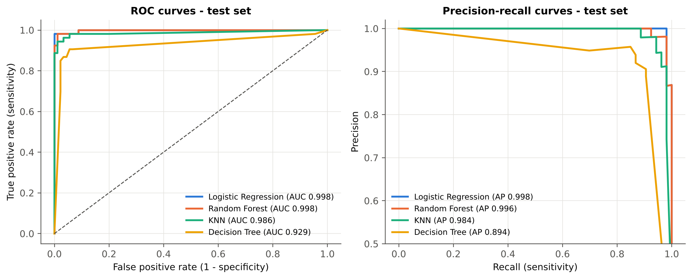
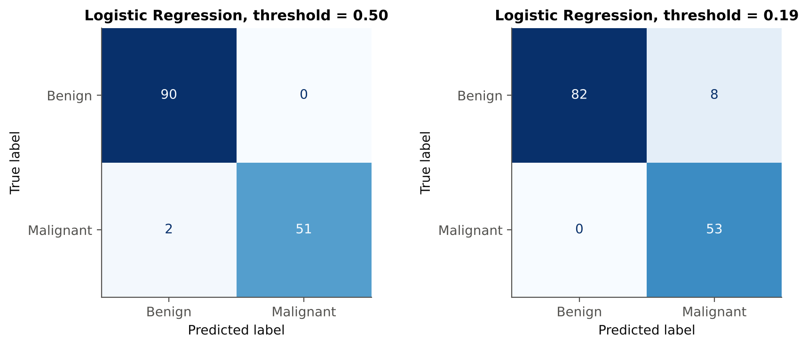

# Breast Cancer Screening with Data Science and Machine Learning

Project for the **YBI Foundation Data Science & Machine Learning Internship** (45 days, 8 July - 25 August 2026).

> Educational project. It is **not** a medical device and must not be used to diagnose or guide treatment.

Using the Wisconsin Diagnostic Breast Cancer (WDBC) dataset, the project covers both halves of the internship:

- **Data science:** a data-quality audit, descriptive statistics, outlier and skewness checks, non-parametric hypothesis tests for every feature, correlation and PCA analysis.
- **Machine learning:** four tuned classifiers compared with cross-validation, a screening threshold chosen so that malignant cases are not missed, model interpretation, and K-means clustering.

## Data analysis

| Check | Result |
|---|---|
| Samples / features | 569 / 30 numeric |
| Missing values, duplicate rows | 0, 0 |
| Class balance | 357 benign (62.7%), 212 malignant (37.3%) |
| Rows with at least one IQR outlier | 171 (kept - real measurements, mostly in the standard-error features) |
| Features with skewness > 1 | 22 of 30 |
| Features that differ between classes (Mann-Whitney U, Bonferroni) | 26 of 30 |
| Principal components for 95% of the variance | 10 |



## Model results (held-out test set, 143 samples)

| Model | CV ROC-AUC (5-fold) | Test accuracy | Test sensitivity | Test specificity | Test ROC-AUC |
|---|---|---|---|---|---|
| **Logistic Regression** | **0.992 ± 0.007** | **0.986** | 0.962 | 1.000 | **0.998** |
| Random Forest | 0.989 ± 0.006 | 0.972 | 0.925 | 1.000 | 0.998 |
| KNN | 0.988 ± 0.006 | 0.958 | 0.906 | 0.989 | 0.986 |
| Decision Tree | 0.954 ± 0.023 | 0.923 | 0.868 | 0.956 | 0.929 |

All at the default 0.50 threshold. Hyper-parameters were tuned with `GridSearchCV` on the training set.

**Screening threshold.** At 0.50, logistic regression misses 2 of 53 malignant test cases. A threshold of **0.19** was chosen on out-of-fold training predictions (target: sensitivity ≥ 98%). On the test set this gives:

| Threshold | Sensitivity | Specificity | Missed malignant | Benign flagged |
|---|---|---|---|---|
| 0.50 | 0.962 | 1.000 | 2 | 0 |
| 0.19 | **1.000** | 0.911 | **0** | 8 |

**K-means (unsupervised).** With k = 2 and no labels, the clusters agree with the diagnosis for 90.5% of samples (ARI 0.65).




## Method

1. Load WDBC from scikit-learn (569 samples, 30 features) and recode the target so 1 = malignant.
2. Audit data quality and test each feature with the Mann-Whitney U test (Bonferroni-corrected).
3. Stratified 75/25 train/test split, seed 42. The test set is used once, at the end.
4. Each model is a `Pipeline` (scaler + classifier), so scaling never sees validation or test data.
5. Grid search with 5-fold stratified CV, scored on ROC-AUC. Model chosen by mean CV ROC-AUC.
6. Threshold picked from out-of-fold probabilities on the training set.
7. Permutation importance and a calibration curve for interpretation.
8. K-means + PCA as an unsupervised check of the data structure.

## Repository

```text
├── app.py                      Streamlit app: screening demo + data explorer
├── notebooks/
│   └── breast_cancer_screening.ipynb   full walkthrough with outputs
├── src/
│   ├── data.py                 loading and stratified split
│   ├── eda.py                  data audit, descriptive statistics, hypothesis tests
│   ├── models.py               the four pipelines and their grids
│   ├── train.py                comparison, selection, threshold, reports
│   ├── clustering.py           K-means + PCA
│   └── plots.py                every figure
├── figures/                    15 PNG charts (analysis and model results)
├── reports/                    data_audit.json, statistical_tests.csv, metrics.json, ...
└── tests/test_pipeline.py
```

## Run it

```bash
pip install -r requirements.txt
python -m src.train        # ~40 s: analysis + training, writes reports/ and figures/
streamlit run app.py
python -m pytest -q
```

## Limitations

- 569 samples from a single centre in the early 1990s; features were measured from digitised images by hand-guided software.
- High scores here do not transfer automatically to other hospitals, scanners or populations.
- The 0.19 threshold reflects one choice of trade-off (missed cancer ≫ extra follow-up). Real use would need clinicians to set that cost, plus external validation, calibration on local data and bias checks.

## Data

`sklearn.datasets.load_breast_cancer` - Wolberg, Street & Mangasarian, UCI Machine Learning Repository.

## Author

Piyush Vashishtha · B.Tech Bioinformatics, Amity University Rajasthan
[GitHub](https://github.com/piyushvashishtha193) · [LinkedIn](https://www.linkedin.com/in/piyushvashishtha)
